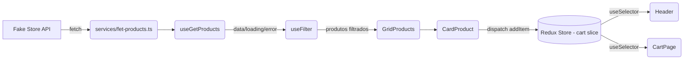

# Arquitetura do Projeto

## Visão geral

O `react-live-code` é uma SPA (Single Page Application) de e-commerce simples
(listagem de produtos, busca e carrinho de compras), construída como
laboratório pessoal de aprendizado. A base do projeto é o **Create React App**
(`react-scripts`) com **React 19** e **TypeScript**, usando **Redux Toolkit**
para estado global, **React Router DOM** para navegação e
**styled-components** para estilização.

O objetivo principal do repositório não é a aplicação em si, mas servir de
campo de testes para:

- Ferramentas do ecossistema React (Redux Toolkit, React Router DOM);
- Padrões de arquitetura em aplicações front-end;
- Boas práticas aplicáveis à manutenção/evolução de aplicações legadas
  (organização por camadas, tipagem, separação de responsabilidades etc.).

## Stack tecnológica

| Camada              | Tecnologia                         | Função                                                   |
|---------------------|-------------------------------------|-----------------------------------------------------------|
| UI                  | React 19 + TypeScript               | Componentização e tipagem estática                        |
| Estilização          | styled-components                   | CSS-in-JS co-localizado por componente                     |
| Roteamento          | react-router-dom v7                 | Navegação entre páginas (`/`, `/cart`)                    |
| Estado global        | @reduxjs/toolkit + react-redux       | Gerenciamento do estado do carrinho de compras             |
| Dados remotos        | Fetch API                           | Consumo da [Fake Store API](https://fakestoreapi.com)      |
| Build/Dev tooling    | react-scripts (CRA)                 | Build, dev server e configuração de testes                 |
| Testes               | @testing-library/react + jest       | Testes de componentes (estrutura pronta via CRA)           |

## Estrutura de pastas

```
src/
├── App.tsx                 # Composição das rotas da aplicação
├── index.tsx                # Bootstrap: BrowserRouter + Redux Provider + StrictMode
├── globals.d.ts             # Augmentação de tipos (ex.: módulos *.css)
├── components/              # Componentes de UI reutilizáveis
│   ├── card-product/         # Card de produto (apresentação + ação "adicionar ao carrinho")
│   ├── filter/                # Input de busca controlado
│   ├── grid-products/         # Orquestra listagem + busca + estados de loading/erro
│   └── header/                 # Cabeçalho com link e contador do carrinho
├── hooks/                    # Hooks customizados (lógica reutilizável)
│   ├── useDebounce.ts          # Debounce genérico de valores
│   ├── useFilter.ts            # Combina busca (debounced) com os produtos
│   └── useGetProducts.ts       # Busca de produtos com cache em memória e cancelamento
├── pages/                    # Páginas/rotas da aplicação
│   ├── home/                   # Página inicial (listagem de produtos)
│   └── cart/                   # Página do carrinho
├── services/                 # Integração com APIs externas
│   └── fetch-products.ts       # Chamada HTTP para a Fake Store API (URL configurável via REACT_APP_API_URL)
├── store/                    # Redux Toolkit
│   ├── index.ts                # configureStore + tipos RootState/AppDispatch
│   └── features/
│       └── cart-slice.ts         # Slice do carrinho (reducers + actions)
└── types/                    # Tipos de domínio compartilhados
    └── get-products.types.ts   # Tipos Product e GetProductsTypes
```

Cada componente/página segue o padrão de **co-localização**: o arquivo de
lógica (`*.tsx`) fica ao lado do arquivo de estilos (`style.ts`), evitando
arquivos de CSS globais espalhados pelo projeto.

## Camadas da aplicação

### 1. Roteamento (`App.tsx` + `index.tsx`)

O `index.tsx` monta a árvore de providers na seguinte ordem:

```
BrowserRouter > React.StrictMode > Provider (Redux) > App
```

O `App.tsx` define as rotas usando `react-router-dom` v7 (`Routes`/`Route`):

- `/` → `Home` (listagem de produtos)
- `/cart` → `CartPage` (carrinho de compras)

### 2. Estado global (Redux Toolkit)

O `store/index.ts` cria a store com `configureStore`, hoje com um único
reducer (`cart`). Os tipos `RootState` e `AppDispatch` são inferidos
automaticamente a partir da store, garantindo tipagem ponta a ponta nos
`useSelector`/`useDispatch`.

O `cart-slice.ts` concentra toda a regra de negócio do carrinho:

- `addItem`: adiciona um produto ou incrementa a quantidade se já existir;
- `removeItem`: remove um item pelo `id`;
- `clearCart`: esvazia o carrinho;
- O total (`total`) é recalculado a cada mutação via `calculateTotal`.

Graças ao Immer (embutido no Redux Toolkit), os reducers escrevem "mutações"
diretas no estado de forma segura e imutável por baixo dos panos.

### 3. Busca de dados (services + hooks)

A camada de serviços (`services/fet-products.ts`) isola o acesso HTTP
(`fetch`) à API externa, retornando dados já tipados (`Product[]`) e lançando
erro em respostas não-ok.

O hook `useGetProducts`:

- Mantém um **cache em módulo** (`productsCache`) para evitar requisições
  repetidas entre montagens do componente;
- Usa `AbortController` para cancelar a requisição se o componente for
  desmontado antes da resposta;
- Expõe o contrato padronizado `{ data, loading, error }`.

O hook `useFilter` compõe `useGetProducts` + `useDebounce` para implementar
busca por texto com debounce de 600ms, evitando refiltragens a cada tecla
digitada (`useMemo` sobre a lista filtrada).

### 4. UI / Componentes

- `GridProducts`: componente "container", consome `useFilter` e trata os
  estados de carregamento, erro e lista vazia antes de renderizar os cards;
- `CardProduct`: componente "apresentacional", recebe o produto via props e
  despacha `addItem` ao Redux quando o usuário adiciona ao carrinho;
- `SearchComponent`: input controlado, recebe `query`/`setQuery` como props;
- `Header`: lê o estado do carrinho via `useSelector` para exibir a
  quantidade total de itens e linka para `/cart`.

### 5. Tipos de domínio

`types/get-products.types.ts` centraliza os tipos `Product` e
`GetProductsTypes`, reutilizados pela store, hooks, serviços e componentes,
evitando duplicação de contratos entre camadas.

## Fluxo de dados (listagem → carrinho)



## Padrões e boas práticas observadas

- **Separação por responsabilidade**: UI (`components`/`pages`), estado
  (`store`), acesso a dados (`services`), lógica reutilizável (`hooks`) e
  contratos (`types`) vivem em pastas próprias.
- **Composição de hooks**: hooks pequenos e focados (`useDebounce`,
  `useGetProducts`) são combinados em hooks de nível mais alto (`useFilter`),
  em vez de concentrar tudo em um único hook monolítico.
- **Co-localização de estilos**: cada componente possui seu próprio
  `style.ts`, facilitando localizar e remover estilos não utilizados.
- **Tipagem ponta a ponta**: `RootState`/`AppDispatch` inferidos da store e
  reaproveitados em todos os `useSelector`/`useDispatch`.
- **Cancelamento de requisições**: uso de `AbortController` para evitar
  atualizações de estado em componentes já desmontados.
- **Cache simples em memória**: evita refetch desnecessário de dados que não
  mudam com frequência (lista de produtos).
- **Imutabilidade via Immer**: reducers do Redux Toolkit escritos de forma
  direta e segura.

## Pontos de atenção / oportunidades de evolução

Como o projeto é um laboratório de aprendizado, alguns pontos ficaram
propositalmente (ou acidentalmente) em aberto e podem ser usados como
exercícios futuros:

- Não há testes automatizados específicos da aplicação além da estrutura
  padrão gerada pelo CRA (`setupTests.js`). O workflow de CI já roda
  `yarn test`, então basta adicionar os arquivos `*.test.ts(x)`.
- O cache de produtos em `useGetProducts` é um módulo-level singleton; em uma
  aplicação maior, isso poderia evoluir para RTK Query ou React Query.
- Não há tratamento de autenticação/usuário. Uma página de cadastro/login é um
  bom próximo passo de estudo (ex.: `src/pages/register`), combinando com os
  temas de formulários controlados e validação.

## Qualidade e automação

- **Licença**: o projeto é distribuído sob a licença [MIT](../LICENSE),
  permitindo uso livre como material de estudo/referência.
- **Integração contínua**: o workflow
  [`.github/workflows/ci.yml`](../.github/workflows/ci.yml) roda `yarn test`
  e `yarn build` a cada push/PR na branch `main`, validando que o projeto
  continua compilando e passando nos testes.
- **Configuração por ambiente**: a URL da API de produtos é lida de
  `REACT_APP_API_URL` (ver [`.env.example`](../.env.example)), com a
  Fake Store API como valor padrão caso a variável não seja definida.

## Como executar

```powershell
yarn install
yarn start   # inicia o servidor de desenvolvimento (CRA)
yarn test    # executa a suíte de testes
yarn build   # gera o build de produção
```

Opcionalmente, copie `.env.example` para `.env` para customizar a URL da API
consumida pela aplicação.
